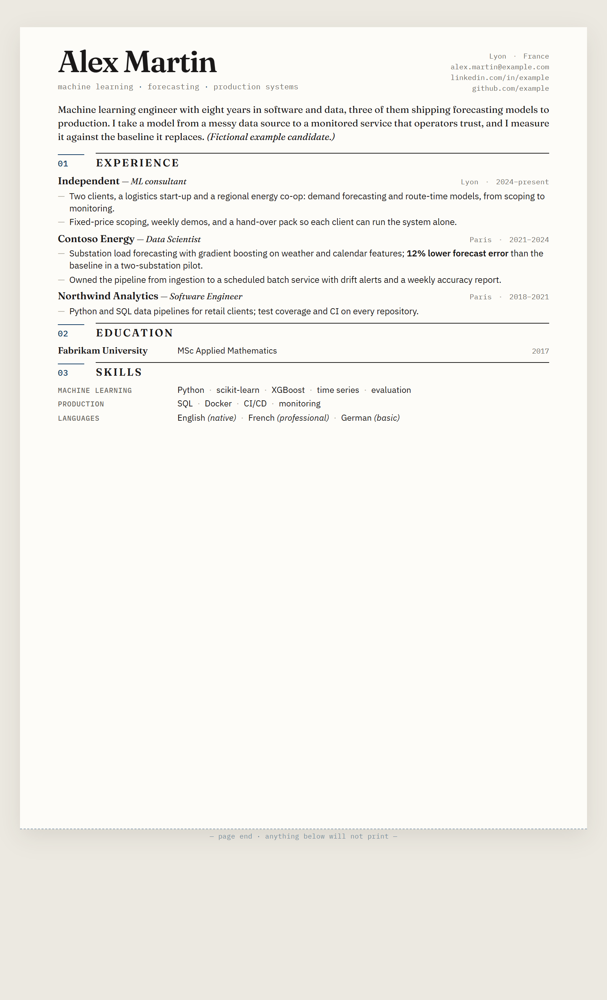

# job-search-wiki

A job search run as an LLM-maintained wiki. You drop in sources (job posts, recruiter emails, call
notes, your LinkedIn export); Claude Code reads them, keeps a cross-linked knowledge base current,
builds a full application package per target, gates every CV and letter before it goes out, and keeps
one honest day-by-day to-do list.

It follows Andrej Karpathy's [LLM Wiki pattern](https://gist.github.com/karpathy/442a6bf555914893e9891c11519de94f):
the human curates and decides, the model does the librarian work. I built and used this structure for
my own search (France return, autumn 2026). This repository is the template, with a **fictional example
candidate**; none of my personal data is in it.



## What's in it

```
CLAUDE.md                       the schema: layers, page conventions, ingest / query / lint, package
                                standard, CV and correspondence rules. Claude Code reads it first.
index.md, log.md                catalogue and append-only operations log
raw/                            immutable sources (personal: keep private)
wiki/
  overview.md                   where things stand, this week
  facts.md                      canonical titles, dates, figures, and a « Never write » list
  sources/ entities/ concepts/  the knowledge base
applications/
  _base/                        one-page A4 CV (HTML/CSS) + _verify.mjs + _gen-pdf.mjs
  _pipeline/                    todo.md, log.md, quality-gate.mjs
  northwind-robotics-2026/      an example package (fictional company)
```

## The parts that earned their place

- **`wiki/facts.md` as the single source of truth.** Titles, dates, figures and language levels drift
  across a dozen CVs, letters and profiles. Every correction lands in one file first, then everywhere.
  Its « Never write » list (a wrong job title, a retired claim) is enforced by the gate.
- **A one-page print gate.** `_verify.mjs` renders the CV in headless Chromium and measures overflow
  against the A4 print area, not the screen. `print_overflow_px` must be negative before a PDF is made.
- **`quality-gate.mjs` before anything is sent:** CV fits one page, no `{{PLACEHOLDER}}` or `‹…›`
  left, employer and role named in the cover text, nothing from « Never write », and a daily cap on
  submissions.
- **A package per target:** job description verbatim, research dossier with sources, tailored CV,
  form answers, outreach notes, and a strategy page that lists what *not* to claim.
- **One to-do list,** rolled forward daily, with everything else (logs, statuses) kept by the model.

## Use it

```bash
npm install                      # Playwright for the CV gate and PDFs
npx playwright install chromium

npm run verify                   # gate the base CV
node applications/_pipeline/quality-gate.mjs applications/northwind-robotics-2026
```

Then open the folder in Claude Code and start with « ingest raw/<file> ». Replace the example candidate
in `wiki/facts.md` and `applications/_base/resume.html` with your own, and keep the repository private
once it holds real data.

## Licence

MIT. See LICENSE.
